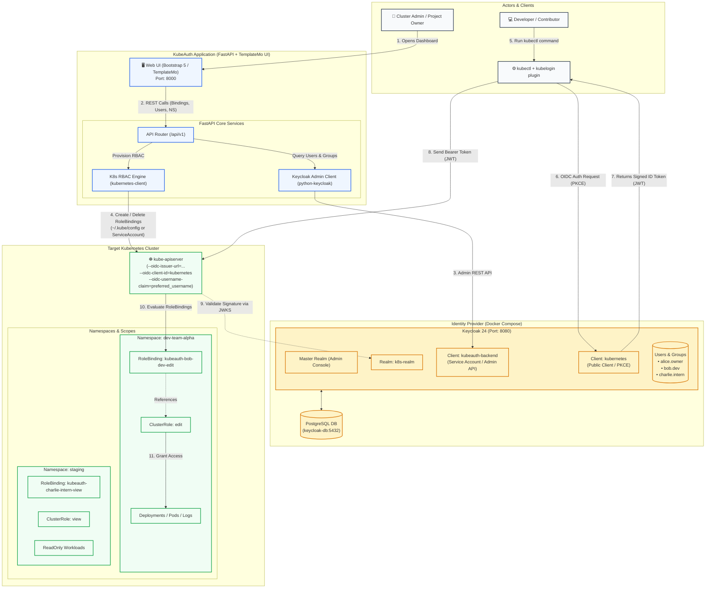
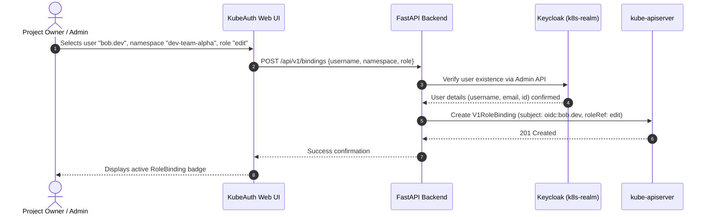
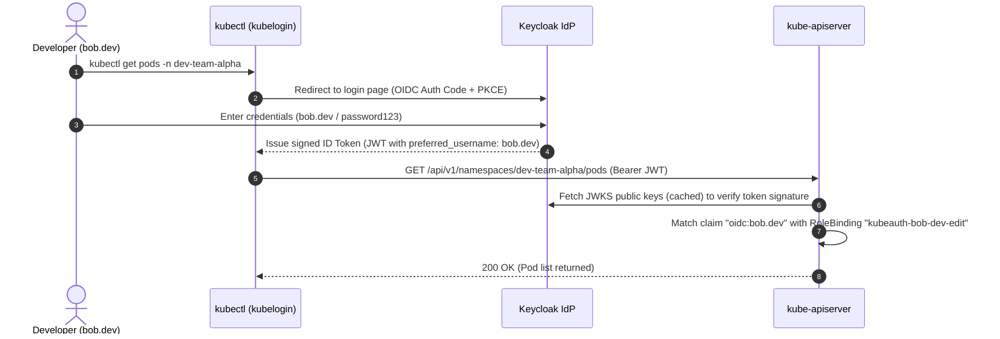

# 🚀 KubeAuth: OIDC Kubernetes RBAC Management Platform

KubeAuth is a centralized Web platform designed to bridge Identity Providers (Keycloak, Azure AD/Entra, Okta, Red Hat SSO) and Kubernetes clusters. It empowers **Project Owners** to manage team membership and granular Kubernetes RBAC permissions across namespaces directly from an intuitive UI, without manually authoring YAML manifests.

---

## 🏛️ System Architecture



---

## 🔄 Sequence Diagram: End-to-End Workflow

### 1. Management Plane: Project Owner assigns a role


### 2. Runtime Plane: Developer connects using `kubectl`


---

## 📁 Project Directory Layout

```text
/home/u268710/kubeauth/
├── README.md                          # Project documentation and architecture
├── docker-compose.yml                  # Keycloak 24 (Quarkus) + PostgreSQL 15
├── .env                                # Runtime configuration & credentials
├── keycloak/
│   └── realm-export.json              # Pre-provisioned realm, OIDC clients, & users
├── backend/
│   ├── config.py                      # Pydantic environment configuration
│   ├── k8s_service.py                 # Kubernetes client wrapper (RoleBindings, NS)
│   ├── main.py                        # FastAPI endpoints and Keycloak Admin integration
│   └── requirements.txt               # Python package dependencies
└── frontend/
    ├── index.html                     # Bootstrap 5 / TemplateMo dashboard UI
    └── static/
        ├── css/style.css              # Custom styling
        └── js/app.js                  # Frontend state management & REST consumer
```

---

## ⚙️ Components Description

| Component | Technology | Purpose |
| :--- | :--- | :--- |
| **Frontend UI** | HTML5, Bootstrap 5, Vanilla JS | Clean dashboard allowing Project Owners to assign/revoke developer access. |
| **API Backend** | Python 3, FastAPI, Uvicorn | Exposes REST APIs, communicates with Keycloak Admin REST API and Kubernetes RBAC API. |
| **Identity Provider** | Keycloak 24, PostgreSQL | Manages enterprise identities, groups, realms, and OpenID Connect tokens. |
| **Kubernetes RBAC Engine** | `kubernetes-client` (SIG) | Creates namespaced `RoleBinding` objects mapping `oidc:<username>` to standard `ClusterRoles` (`edit`, `view`, `admin`). |

---

## 🚀 Quick Start Guide

### 1. Launch Keycloak and Database
```bash
cd /home/u268710/kubeauth
docker compose up -d
```
- **Keycloak Admin Console**: `http://localhost:8080/admin`
- **Default Credentials**: `admin` / `adminpassword`
- **Imported Realm**: `k8s-realm`
- **Pre-configured Test Users** (password for all: `password123`):
  - `alice.owner` (Project Owner)
  - `bob.dev` (Developer)
  - `charlie.intern` (Intern / Viewer)

### 2. Start the Backend & Web UI
```bash
cd /home/u268710/kubeauth/backend
python3 -m venv venv
source venv/bin/activate
pip install -r requirements.txt
python main.py
```

### 3. Open the Web Application
Navigate to:
👉 **`http://localhost:8000`**

---

## 🔒 Kubernetes Cluster Configuration (kube-apiserver)

When setting up your `kubeadm` cluster, add these arguments to `/etc/kubernetes/manifests/kube-apiserver.yaml`:

```yaml
spec:
  containers:
  - command:
    - kube-apiserver
    - --oidc-issuer-url=http://<KEYCLOAK_HOST_IP>:8080/realms/k8s-realm
    - --oidc-client-id=kubernetes
    - --oidc-username-claim=preferred_username
    - --oidc-username-prefix=oidc:
    - --oidc-groups-claim=groups
    - --oidc-groups-prefix=oidc:
```
